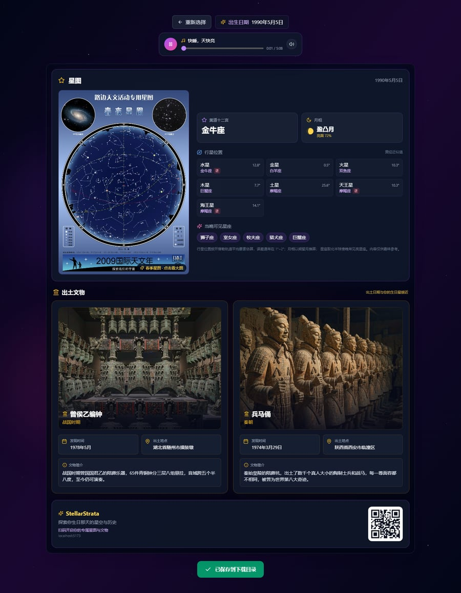

# StellarStrata · 生日星图与文物

输入出生日期，换取两张卡片：那天夜里抬头能看见的**星空星图**，以及那一天在历史中**出土的文物**。
整页可一键导出为带站点二维码的 PNG，直接分享。

在线访问：<https://michuan.github.io/StellarStrata/>



## ✨ 功能特性

- 🗓️ **日期选择**：年 / 月 / 日下拉 + 日历，支持手动输入后回车直达；年份列表跟随当前年份，上限为今天
- 🌌 **星图卡片**
  - 按季节展示春 / 夏 / 秋 / 冬四季北半球星图海报（可点击查看大图）
  - 黄道十二宫、月相（含 SVG 月相图标与亮面百分比）
  - 七颗行星的所在星座与度数，并标注是否逆行
  - 当晚可见星座，按季节给出，同一日期结果稳定不跳变
- 🏺 **文物卡片**：优先匹配「同一天出土」的文物，没有则给出出土日期最接近的两件，并标明匹配方式
- 🎵 **背景音乐**：首页与结果页各一个播放器，支持播放 / 暂停、进度拖动、静音、加载失败提示
- 🖼️ **一键导出**：导出前等待图片解码完成，图片底部带站点二维码与网址，方便扫码传播
- 📱 **响应式**：桌面双栏、移动端单栏，无横向滚动
- 🚀 **自动部署**：GitHub Actions 构建并发布到 GitHub Pages

## 🛠️ 技术栈

- React 18 + TypeScript + Vite 6
- Tailwind CSS 3
- react-datepicker（日期选择）
- html2canvas（导出图片，按需加载）+ qrcode（二维码，按需加载）
- lucide-react（图标）

## 🔭 数据说明

| 数据 | 来源与精度 |
| --- | --- |
| 星座（太阳星座） | 按通行的日期分界表判定 |
| 月相 | 以 2000-01-06 的一次新月为起点按朔望月（29.5306 天）推算，含亮面百分比 |
| 行星位置 | 平均轨道要素 + 开普勒方程求地心黄经，忽略轨道倾角与主要摄动，误差通常 1°~2° |
| 可见星座 | 按北半球傍晚常见亮星座分季节整理，随日期轮换 |
| 四季星图 | 春季 / 夏季 / 秋季 / 冬季星图海报，构建时压缩为 WebP |

> 以上天象数据为**趣味性近似**，不适用于占星、航海或天文观测定位。

## 🖼️ 图片素材

`src/assets/artifacts/` 下的 12 张文物图为 AI 生成的示意图（已裁去水印并压缩至 36–150 KB/张），
仅用于页面氛围与卡片展示，与真实文物的形制细节可能存在差异；如需严谨展示，请替换为馆藏实拍图并注明来源。

## 💻 本地开发

```bash
npm install
npm run dev      # 开发服务器 http://localhost:5173
npm run build    # 生产构建，输出到 dist/
npm run preview  # 预览生产构建
npm run lint     # ESLint 检查
```

## 🚀 部署

### GitHub Pages

仓库内置工作流 `.github/workflows/deploy.yml`，推送到 `main` 即自动构建并部署。

首次使用需在仓库中开启 Pages：

1. 进入 **Settings → Pages**
2. **Build and deployment → Source** 选择 **GitHub Actions**
3. 推送到 `main`，等待 Actions 完成
4. 访问 `https://<用户名>.github.io/StellarStrata/`

### 其他平台（Cloudflare Pages / Vercel / 域根部署）

构建时通过环境变量注入子路径：

```bash
VITE_BASE_PATH=/StellarStrata/ npm run build   # 子路径部署
npm run build                                  # 域根部署（默认 '/'）
```

`vite.config.ts` 的 `base` 与页面内音乐、二维码等运行时路径都由该变量推导，无需改代码。

## 📁 目录结构

```
src/
├── components/
│   ├── DatePicker.tsx      # 日期选择面板
│   ├── StarChartCard.tsx   # 星图卡片（海报 + 天象数据）
│   ├── MoonPhaseIcon.tsx   # SVG 月相图标
│   ├── ArtifactCard.tsx    # 文物卡片
│   ├── MusicPlayer.tsx     # 背景音乐播放器
│   ├── ExportButton.tsx    # 导出为图片
│   └── ShareFooter.tsx     # 二维码页脚
├── data/
│   ├── astronomy.ts        # 简化星历：太阳/行星黄经、月相、季节星座
│   └── artifacts.ts        # 文物数据与「同日出土 / 最接近」匹配逻辑
├── assets/
│   ├── starcharts/         # 四季星图 spring/summer/autumn/winter.webp
│   └── artifacts/          # 文物图片 1~12.jpg（随构建打包）
├── pages/Home.tsx          # 主页面与结果区布局
├── App.tsx                 # 路由（支持子路径 basename）
└── index.css               # 全局深色主题、动画与日期组件样式
public/
└── music/                  # home.mp3（首页）/ card.mp3（结果页）
```

## 🗒️ 更新日志

### v1.0.0

**修复**

- 整页泛白：`body` 缺少深色底色，带透明度的主背景渐变叠在白画布上被冲淡成灰紫色；现由 `html/body` 提供 `#05070f` 底色并声明 `color-scheme: dark`
- 文物图片全部是「The image is generating…」占位图：原数据引用已失效的远程文生图接口，现改为 12 张随构建打包的本地图片，并保留加载失败兜底
- 2000 年之前出生时月相为空：朔望月取模得到负数索引，已修正为正取模
- 音乐在 GitHub Pages 子路径下 404：`/music/*.mp3` 改为基于 `BASE_URL` 拼接
- 文物与可见星座每次刷新都在变：改为按日期确定性生成
- 日期选择器年份写死到 2025：改为按当前年份生成，并禁止选择未来日期
- 首页星点每次重渲染重新排布导致「跳动」：星点位置改为模块级常量

**优化**

- 四季星图 4 × 9.7 MB → 4 × 约 0.3 MB（WebP，32× 体积下降）；文物图统一 840px 宽
- 移除 Google Fonts 外链与未使用的 `sharp` / `zustand` / `clsx` 等依赖；删除空组件与 Trae 专用 Babel 插件
- `html2canvas` 与 `qrcode` 改为点击时按需加载，首屏 JS 体积明显下降；不再输出 sourcemap
- 结果页重排为「星图卡片（海报 + 数据）+ 双列文物卡片」，桌面与移动端都不再有明显留白或挤压
- 去掉 1 秒的假加载等待，改为入场动画
- 卡片内不再使用 `backdrop-filter` 与内部模糊光斑，导出的 PNG 与页面表现一致
- 补齐 `<meta>` 描述、OG 标签与 `theme-color`，补充按钮与图片的 `aria-label` / `alt`

## 📄 License

[MIT](LICENSE)
